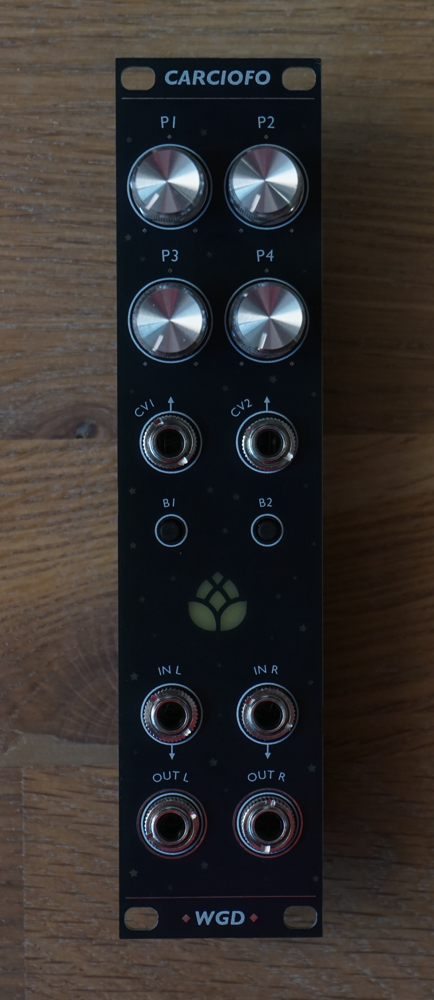

# carciofo-firmware

A repository to collect different firmwares for the daisy-based Carciofo module, the 6hp successor of the [Löwenzahnhonig](https://github.com/wgd-modular/loewenzahnhonig-firmware). Same four pots and two CV inputs, plus two buttons and an RGB LED.




## Flash your module

Flash your module straight from the browser with the [Carciofo web flasher](https://wgd-modular.github.io/carciofo-firmware/). Open it in Google Chrome or Edge, connect the Daisy Seed over USB, hold BOOT and tap RESET to enter the bootloader, then pick a firmware and press flash. It lists every firmware of the latest release together with its controls, and can also flash a local `.bin` you built yourself.

Prefer to grab the raw binaries? Every firmware is pre-compiled and attached to the [latest release](https://github.com/wgd-modular/carciofo-firmware/releases/latest).


## Manual

The [Carciofo manual](https://github.com/wgd-modular/carciofo-firmware/releases/latest/download/carciofo-manual.pdf) is a PDF covering the module itself, how to flash it and every firmware of the latest release with all its controls. It is built from this repository, so it always matches the firmwares it comes with.


## Controls

One side of the modules front panel has a generic labelling. This table contains a mapping of which control is associated with which pin of the daisy seed.

| **Control** | **Daisy Pin** |
|------------ | ------------- |
| P1          | A0            |
| P2          | A1            |
| P3          | A2            |
| P4          | A3            |
| CV1         | A4            |
| CV2         | A5            |
| B1          | D6            |
| B2          | D7            |
| LED         | D5            |


# Compilation

This step is only required if you want to modify a firmware or create your own. The firmwares depend on the `libDaisy` and `DaisySP` development libraries by Electro-Smith. These are added as submodules to this repository and are most easily fetched when initially cloning the repository as follows:

```shell
git clone --recursive https://github.com/wgd-modular/carciofo-firmware
```

If you cloned without `--recursive`, fetch them afterwards with `git submodule update --init --recursive`.

Everything else, the ARM GCC toolchain, `make` and Python included, is managed by [pixi](https://pixi.sh), so nothing has to be installed system-wide apart from pixi itself. It works the same on Linux and macOS (Intel and Apple Silicon); on Windows use WSL. To compile all firmwares run:

```shell
pixi run build
```

The first run sets up the toolchain and compiles both libraries, later runs reuse them. To compile one specific firmware, pass its name:

```shell
pixi run build reverb
```

This places the firmware in `src/reverb/build/reverb.bin`, ready for the web flasher. `pixi run build-libs` only rebuilds the libraries, and `pixi run clean` removes all build output again.

The manual is built in the same way, with its own small environment, into `manual/build/carciofo-manual.pdf`:

```shell
pixi run manual
```

When working on a single firmware it can be handy to drop into the environment with `pixi shell` and call `make` inside the firmware's folder directly.


## Writing a firmware

`lib/carciofo.h` covers the panel so that a firmware does not have to repeat the ADC setup, the button debouncing and the LED timing every time:

```cpp
#include "../../lib/carciofo.h"

using namespace daisy;
using namespace carciofo;

Carciofo hw;
float gain;

void AudioCallback(AudioHandle::InputBuffer in, AudioHandle::OutputBuffer out,
                   size_t size) {
  for (size_t i = 0; i < size; i++) {
    out[0][i] = in[0][i] * gain;
    out[1][i] = in[1][i] * gain;
  }
}

int main(void) {
  hw.Init();
  hw.StartAudio(AudioCallback);

  while (1) {
    hw.ProcessControls();
    gain = hw.button[BUTTON_1].Pressed() ? 0.f : hw.GetPotWithCv(POT_1, CV_1);
    hw.led.SetHsv(0.33f, 1.f, gain);
    System::Delay(1);
  }
}
```

`ProcessControls()` debounces both buttons and pushes the staged LED colour, so it belongs at the top of the main loop. `GetPot()` and `GetCv()` hand back 0 to 1, `GetPotWithCv()` sums the two and clamps. The buttons are plain libDaisy `Switch` objects, the LED takes either RGB or HSV.


## Contributing

New firmwares for the Carciofo module are always very welcome. Feel free to open a PR anytime. Each new firmware should be located in a new sub-folder with the same name as the `.cpp` file together with a `README.md` file telling users about the controls and other possibly interesting stuff.

That README also becomes the firmware's chapter in the manual, no extra work needed. The first `#` heading is taken as the firmware's name, any text before the first `##` heading as its introduction, and every `##` heading becomes a section of the chapter. A section called `## Controls` with a table of the controls is shown on the web flasher too and gets highlighted in the manual. Who worked on a firmware and when it last changed is read from the git history of its folder, co-authors included.
